# FTP con Vagrant y Ansible

**Autor:** Pablo Molina Calvente
**Repositorio:** https://github.com/pmolcal/ftp-vagrant-ansible
**Dominio de la práctica:** `pablo.test`

En esta práctica he montado una pequeña red de tres máquinas virtuales Debian 12 (bookworm) con Vagrant. Todos los servicios los configuro desde una de ellas con Ansible, sin tocar los servidores a mano. La idea es que, con el repositorio clonado, cualquiera pueda levantar el mismo entorno y obtener el mismo resultado.

| Máquina | IP | Papel |
|---|---|---|
| `dns` | 192.168.57.5 | Servidor DNS autoritativo de `pablo.test` (BIND9) |
| `ansible` | 192.168.57.6 | Nodo de control: desde aquí lanzo los playbooks |
| `negocio` | 192.168.57.7 | Servidor web (Apache) y servidor FTP seguro (vsftpd + TLS) |

`www.pablo.test` y `ftp.pablo.test` son registros CNAME que apuntan a `negocio.pablo.test`, así que el servidor web y el FTP comparten máquina, pero se llega a cada uno por su nombre.

A continuación cuento lo que he hecho en el mismo orden en que lo hice, con la captura de cada paso debajo.

---

## Índice

1. [Herramientas](#1-herramientas)
2. [GitHub y gestión del proyecto](#2-github-y-gestión-del-proyecto)
3. [Licencia y README](#3-licencia-y-readme)
4. [Vagrant: las tres máquinas](#4-vagrant-las-tres-máquinas)
5. [Ansible: configuración e inventario](#5-ansible-configuración-e-inventario)
6. [Servidor DNS](#6-servidor-dns)
7. [Servidor web](#7-servidor-web)
8. [Servidor FTP](#8-servidor-ftp)
9. [Pruebas con FileZilla](#9-pruebas-con-filezilla)
10. [Provisión completa y tablero final](#10-provisión-completa-y-tablero-final)
11. [Problemas que me encontré y cómo los resolví](#11-problemas-que-me-encontré-y-cómo-los-resolví)
12. [Cambios respecto al enunciado](#12-cambios-respecto-al-enunciado)
13. [Riesgos de seguridad](#13-riesgos-de-seguridad)
14. [Conclusión](#14-conclusión)

---

## 1. Herramientas

Antes de empezar comprobé las versiones de lo que iba a usar en Windows: Git 2.51, Vagrant 2.4.9 y VirtualBox 7.2.

```
git --version
vagrant --version
"C:\Program Files\Oracle\VirtualBox\VBoxManage.exe" --version
```


---

## 2. GitHub y gestión del proyecto

Creé el repositorio público `ftp-vagrant-ansible`. Ahí está todo el código de infraestructura (Vagrantfile, playbooks, configuraciones) con su historial de commits.


Desde *Settings → Collaborators* invité al profesor (`frayalzv`) para que pueda seguir el proyecto.


Para organizar el trabajo creé un proyecto en GitHub Projects con vista de tablero. La plantilla trae las columnas en inglés.


Las renombré a **Por hacer**, **En progreso** y **Hecho** y empecé a crear issues, la primera la de la licencia.


Después creé el resto siguiendo el enunciado: una issue principal por apartado y sus sub-issues, cada una con el objetivo y la comprobación para darla por terminada. En total, 40.

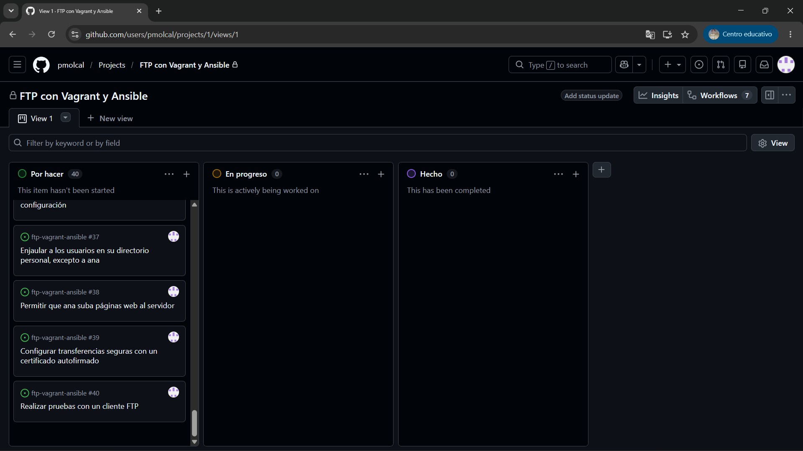

Mi forma de trabajar fue esta: al empezar una tarea la pasaba a *En progreso*, en los commits intermedios ponía `Refs #n`, y cuando estaba comprobada hacía un commit con `Closes #n`. Al llegar ese commit a `main`, GitHub cierra la issue y el flujo del proyecto la mueve sola a *Hecho*.

---

## 3. Licencia y README

Elegí la licencia **MIT**: es corta y permite usar, modificar y redistribuir el proyecto siempre que se mantenga el aviso de copyright. El texto completo está en `LICENSE`.


En el `README.md` principal explico el objetivo, las herramientas y cómo poner el proyecto en marcha. Lo hice sub-issue por sub-issue (#3 a #6) y al final cerré la principal (#2).

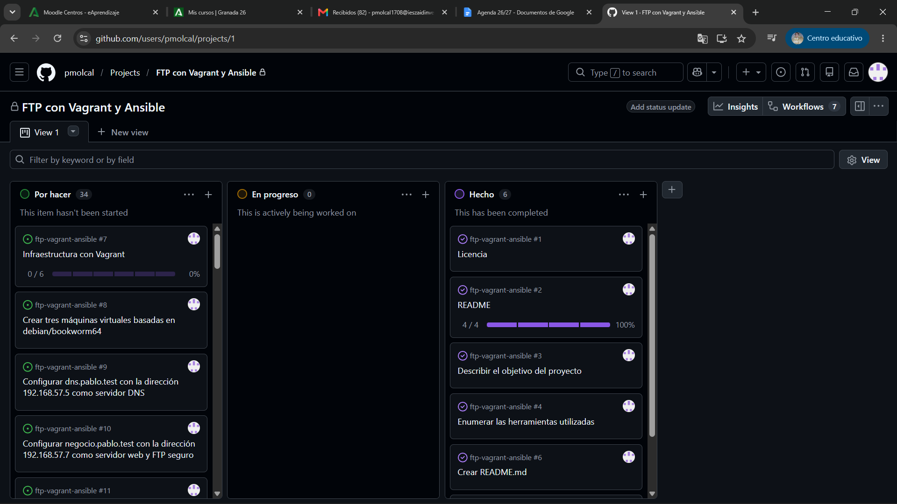

---

## 4. Vagrant: las tres máquinas

El `Vagrantfile` define las tres máquinas a partir de la box `debian/bookworm64`, cada una con su `hostname` y su IP en una red privada (`private_network`) común, la `192.168.57.0/24`. Solo la máquina `ansible` tiene un provisionador: ejecuta `script/ansible.sh`, que instala Ansible y copia los ficheros del proyecto.

```ruby
config.vm.define "ansible" do |ansible|
  ansible.vm.hostname = "ansible.pablo.test"
  ansible.vm.network "private_network", ip: "192.168.57.6"
  ansible.vm.provision "shell", path: "script/ansible.sh"
end
```

El script lo fui completando poco a poco: el enunciado lo da con casi todo comentado y vas descomentando líneas a medida que creas los ficheros. Después de cada cambio hacía `vagrant provision ansible` para que la máquina recogiera lo nuevo.

Con `vagrant up` se levantan las tres, y `vagrant status` confirma que están en `running`. Ya dentro de `ansible` (`vagrant ssh ansible`), `ansible --version` muestra ansible-core 2.14.

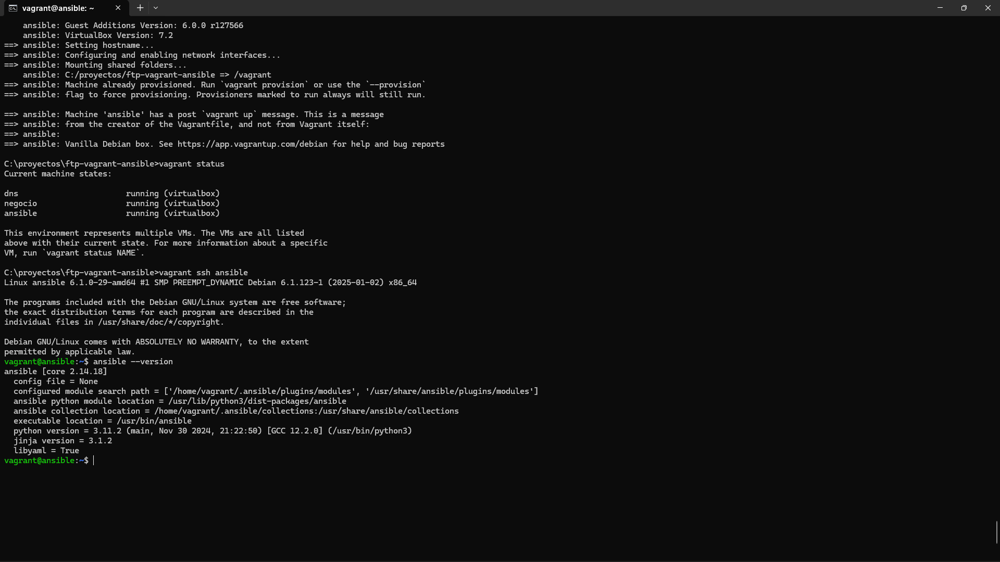

---

## 5. Ansible: configuración e inventario

En `ansible.cfg` dejé las opciones comunes a todas las conexiones:

```ini
[defaults]
remote_user = vagrant
host_key_checking = False
interpreter_python = auto_silent
inventory = inventory.yml
```

- `remote_user`: el usuario SSH con el que Ansible entra en los servidores.
- `host_key_checking = False`: no comprueba la huella SSH del servidor la primera vez que se conecta. Para un laboratorio que se destruye y se vuelve a crear es cómodo, pero quita una protección contra suplantación, así que en producción no lo pondría.
- `inventory`: el inventario por defecto, para no tener que escribir `-i inventory.yml` cada vez.

El inventario (`inventory.yml`) declara los dos servidores gestionados con su IP privada y la clave privada que Vagrant generó para cada uno:

```yaml
all:
  hosts:
    dns:
      ansible_host: 192.168.57.5
      ansible_ssh_private_key_file: /home/vagrant/claves/dns_key
    negocio:
      ansible_host: 192.168.57.7
      ansible_ssh_private_key_file: /home/vagrant/claves/negocio_key
```

Las claves no se leen desde `/vagrant` porque en Windows esa carpeta compartida tiene permisos `0777`, y SSH rechaza una clave privada tan abierta (`UNPROTECTED PRIVATE KEY FILE`). Por eso `ansible.sh` las copia a `/home/vagrant/claves` con permisos `600`.

Para comprobar la conexión usé `ansible all -m ping`, que no es un ping ICMP: entra por SSH y comprueba que Ansible puede ejecutar módulos. Después lancé `uptime` con `-b` (become, es decir, con sudo). Los dos servidores respondieron `SUCCESS` y `rc=0`.


---

## 6. Servidor DNS

La carpeta `dns/` contiene el playbook y los ficheros de BIND:

```
dns/
├── dns.yml
├── test.sh
└── files/
    ├── named.conf.options   # opciones; recursión solo para localhost y 192.168.57.0/24
    ├── named.conf.local     # declara la zona pablo.test y la inversa 57.168.192.in-addr.arpa
    ├── db.pablo.test        # SOA, NS, registros A (dns, negocio) y CNAME (www, ftp)
    └── db.192.168.57        # registros PTR para la resolución inversa
```

El playbook instala `bind9`, copia las configuraciones a `/etc/bind/` y las zonas a `/var/lib/bind/` (con dueño `bind`, para que el servicio pueda leerlas) y valida todo con `named-checkconf` y `named-checkzone` antes de reiniciar. El reinicio va en un *handler*, así que solo ocurre si algún fichero ha cambiado.


Desde Windows pregunté directamente al servidor con `nslookup nombre 192.168.57.5`. Resuelven los nombres directos, `www` y `ftp` aparecen como alias de `negocio`, y las dos inversas devuelven su nombre.

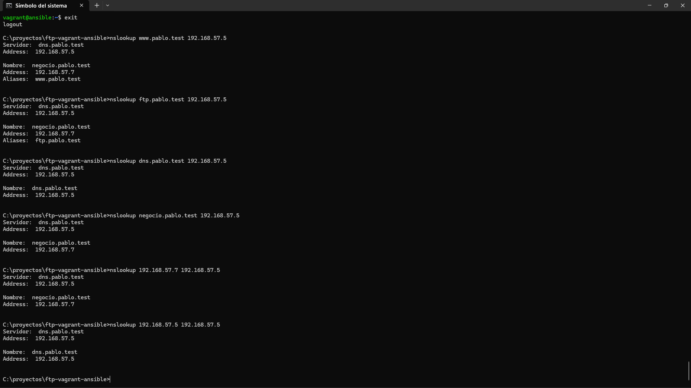

Para no repetir esas pruebas a mano escribí `dns/test.sh`, que lanza `dig` contra cada registro (A, CNAME y PTR), compara el resultado con el esperado y devuelve un código distinto de 0 si algo falla. Se ejecuta con `vagrant ssh dns -c "bash /vagrant/dns/test.sh"`.


Por último hice que Windows usara este DNS, para poder escribir `www.pablo.test` en el navegador y `ftp.pablo.test` en FileZilla. Aquí se ve `nslookup www.pablo.test` ya sin indicar servidor, y que internet sigue funcionando (ping a google.com).


---

## 7. Servidor web

El playbook `web/web.yml` instala `apache2`, publica `files/index.html` en `/var/www/html/` y deja el servicio habilitado y arrancado. Igual que en el DNS, Apache solo se reinicia si la página ha cambiado.

La primera vez falló en la tarea de instalar Apache con `E: dpkg was interrupted`, porque una instalación anterior se quedó a medias cuando me quedé sin disco. Lo arreglé desde el nodo de control, sin entrar en `negocio`:

```bash
ansible negocio -b -a "dpkg --configure -a"
ansible negocio -b -a "apt-get install -f -y"
```

y al repetir el playbook terminó con `failed=0`.


La página responde en `http://www.pablo.test`. Tiene que ser `http://`: Apache solo escucha en el puerto 80, sin HTTPS.


`web/test.sh` hace la misma comprobación de forma automática: pide la página con `curl`, verifica que el código HTTP es 200 y que el contenido incluye "Servidor web de pablo.test".


---

## 8. Servidor FTP

Esta es la parte central de la práctica. El FTP corre en `negocio` con **vsftpd**, y estos son los requisitos:

- Modo independiente (*standalone*), sin depender de inetd, y escuchando solo en IPv4.
- Sin acceso anónimo: solo usuarios locales autenticados.
- Usuarios `juan` y `ana`, con contraseñas `juan` y `ana`.
- `juan` enjaulado (*chroot*) en su directorio personal; `ana` libre y con permiso para publicar en `/var/www/html`.
- Transferencias cifradas con FTP explícito sobre TLS (FTPES) y un certificado autofirmado.

```
ftp/
├── ftp.yml
├── files/
│   ├── vsftpd.conf
│   ├── vsftpd.chroot_list   # usuarios que NO se enjaulan (ana)
│   └── ana                  # configuración propia de ana
└── vars/
    ├── vault.yml            # hashes cifrados con Ansible Vault
    └── vault.yml.example    # misma estructura, sin datos reales
```

### 8.1. Contraseñas con Ansible Vault

El módulo `ansible.builtin.user` no acepta la contraseña en claro: espera el hash en el mismo formato que `/etc/shadow`. Lo generé con `mkpasswd` (del paquete `whois`) usando SHA-512, así que cada hash empieza por `$6$`. Como cada ejecución usa una *salt* aleatoria, aunque repitas la contraseña el hash sale distinto.

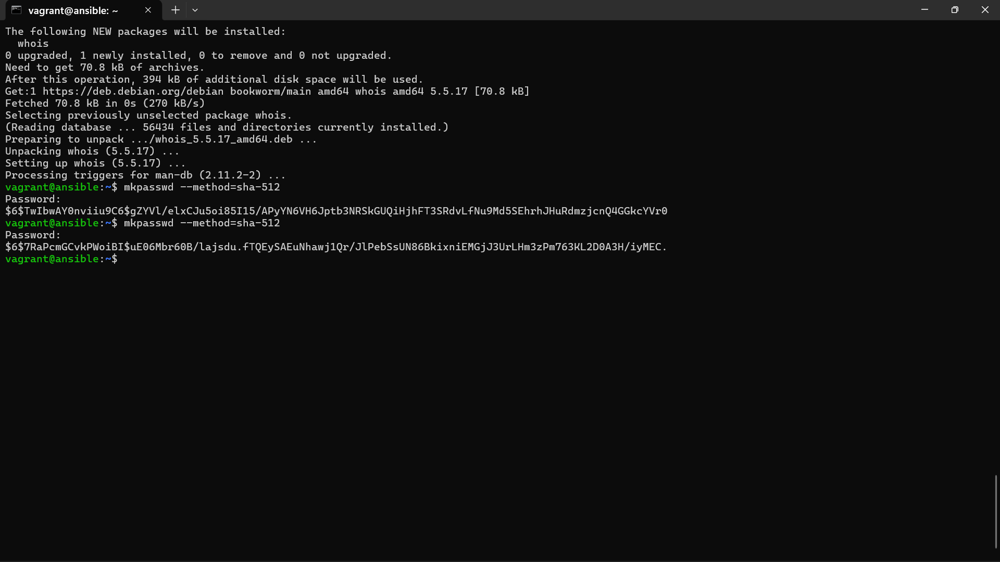

Los hashes no deben quedar a la vista en el repositorio, así que van en `ftp/vars/vault.yml`, cifrado con AES-256 por **Ansible Vault**. La contraseña maestra es `daw`. Lo creé con `nano` como editor:

```bash
export EDITOR=nano
ansible-vault create /vagrant/ftp/vars/vault.yml
```


En esta captura se ve mi primer intento. Me olvidé de cambiar los marcadores por los hashes de verdad, y más adelante eso me dio problemas al entrar por FTP. Lo cuento en el apartado 11.

Una vez cifrado, el fichero empieza por `$ANSIBLE_VAULT;1.1;AES256` y el resto es ilegible:

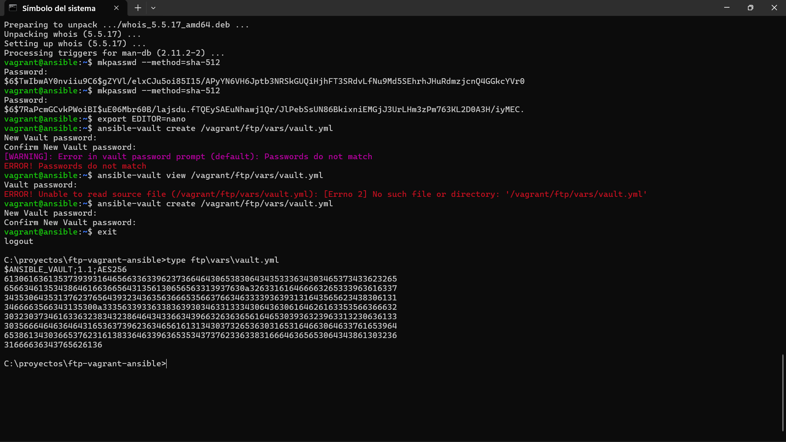

Junto al vault subí `vault.yml.example`, que tiene la misma estructura pero con marcadores, como referencia. También subí `vault_pass.txt` con la contraseña `daw` para que la provisión pueda descifrar el vault sin preguntar (`--vault-password-file`). El enunciado pide hacerlo así para agilizar las pruebas, pero en un proyecto real esa contraseña nunca iría al repositorio.

### 8.2. Configuración de vsftpd

Partí de la plantilla del enunciado y rellené los huecos. Las opciones importantes son estas:

```ini
# Modo independiente IPv4
listen=YES
listen_ipv6=NO

# Solo usuarios locales autenticados
anonymous_enable=NO
local_enable=YES
write_enable=YES
pam_service_name=vsftpd

# Enjaulado por defecto, excepto los de la lista (ana)
allow_writeable_chroot=YES
chroot_local_user=YES
chroot_list_enable=YES
chroot_list_file=/etc/vsftpd.chroot_list
user_config_dir=/etc/vsftpd_user_conf

# Certificado y clave privada
rsa_cert_file=/etc/ssl/ftp/pablo.test.crt
rsa_private_key_file=/etc/ssl/ftp/pablo.test.key
```

- `listen=YES` con `listen_ipv6=NO` hace que vsftpd sea su propio demonio, sin inetd, y que abra el socket solo en IPv4. Con `listen_ipv6=YES` escucharía en `[::]` y aceptaría las dos familias.
- `pam_service_name=vsftpd` delega la autenticación en PAM (`/etc/pam.d/vsftpd`), que comprueba la contraseña contra `/etc/shadow`.
- Con `chroot_local_user=YES` y `chroot_list_enable=YES`, la lista funciona como **excepción**: se enjaula a todos menos a los usuarios que aparecen en `vsftpd.chroot_list`.
- `allow_writeable_chroot=YES`: desde la versión 3, vsftpd se niega a enjaular a un usuario si puede escribir en la raíz de su jaula, y corta la sesión con `500 OOPS: refusing to run with writable root inside chroot()`. Como `/home/juan` es de juan, sin esta opción no podría entrar. El riesgo es que un usuario con escritura en la raíz de su jaula podría colocar ahí ficheros que engañen a programas del sistema e intentar escapar. Lo correcto en producción sería una raíz de root sin escritura y una subcarpeta para subir.
- `user_config_dir` permite tener un fichero de configuración por usuario. En `/etc/vsftpd_user_conf/ana` pongo `local_root=/var/www/html`, y así ana aparece directamente en la carpeta de la web al conectarse.
- La plantilla ya traía la parte de TLS (`ssl_enable=YES`, `force_local_logins_ssl=YES`, `force_local_data_ssl=YES`, que obligan a cifrar el login y los datos) y el modo pasivo en los puertos 40000-40100.

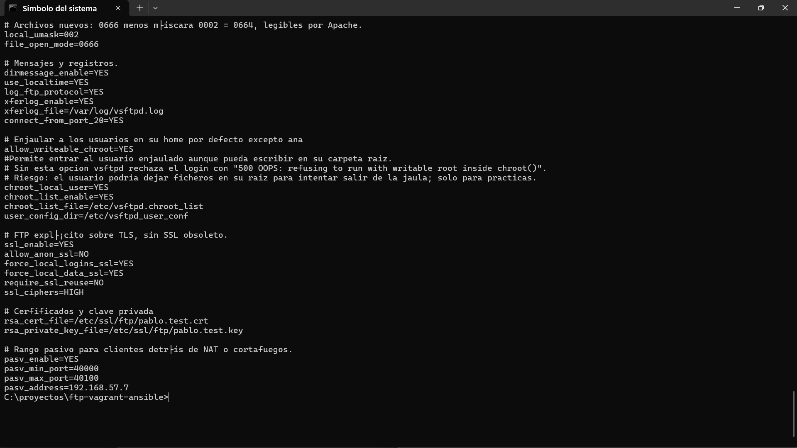

### 8.3. El playbook del FTP

`ftp/ftp.yml` lee los hashes del vault (`vars_files: vars/vault.yml`) y hace esto, en orden:

1. Instala `vsftpd` y `python3-cryptography` (la necesitan los módulos de `community.crypto`).
2. Crea los grupos `ftpusers` y `webpublish`.
3. Crea a `juan` y `ana` con `password: "{{ ftp_password_hashes[item] }}"`, y añade a `ana` a `webpublish`.
4. Deja `/var/www/html` como `root:webpublish` con modo `2775`. El `2` es el bit **setgid**: todo lo que se cree dentro hereda el grupo `webpublish` y no el grupo personal de quien lo sube. El `index.html` que ya existía lo pasa a `0664`, porque el setgid solo afecta a ficheros nuevos y ana no podría sobrescribir uno que fuera `root:root 0644`.
5. Genera la clave RSA de 2048 bits (`openssl_privatekey`), el CSR (`openssl_csr_pipe`) con `pablo.test` como CN y `ftp.pablo.test` y `www.pablo.test` en el SAN, y el certificado autofirmado válido 365 días (`x509_certificate`).
6. Copia `vsftpd.chroot_list`, la configuración de ana y `vsftpd.conf`. Si alguno cambia, avisa al *handler* que reinicia vsftpd.

Descomenté en `ansible.sh` la copia de la carpeta `ftp` y de la contraseña del vault, y reprovisioné la máquina `ansible`:


Antes de ejecutarlo, un `--syntax-check` para asegurarme de que el YAML se interpreta bien:

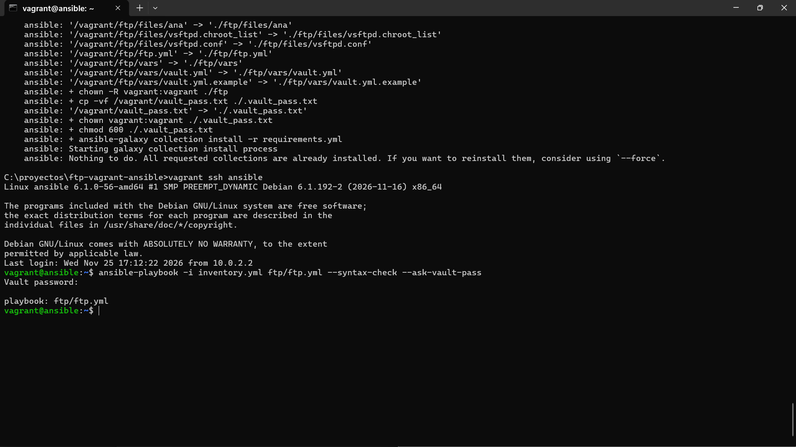

Y la ejecución real:

```bash
ansible-playbook -i inventory.yml ftp/ftp.yml --ask-vault-pass
```

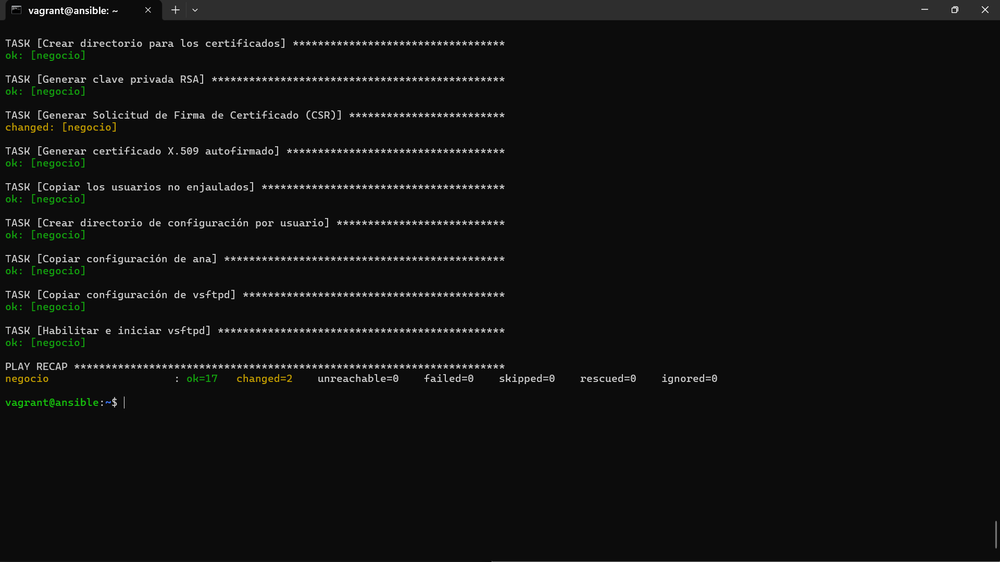

### 8.4. Comprobaciones desde la terminal

Antes de abrir FileZilla quise comprobar cada requisito por separado desde la línea de comandos. Todas estas órdenes las lancé desde el nodo `ansible`, salvo las de `curl`, que lancé desde Windows.

**Modo independiente e IPv4.** `systemctl status vsftpd` muestra el servicio `active (running)` con el proceso `/usr/sbin/vsftpd /etc/vsftpd.conf`: vsftpd es su propio demonio y no hay inetd por medio. Con `ss -tlnp`, el puerto 21 aparece en `0.0.0.0:21` y no hay ningún `[::]:21`.


**Usuarios, grupos y permisos.** `id` confirma los grupos de cada usuario, y `ls -ld` muestra la carpeta web con el setgid (`drwxrwsr-x root webpublish`) y el `index.html` escribible por el grupo (`-rw-rw-r-- root webpublish`).


**Certificado.** Con `openssl s_client` negocio TLS sobre FTP igual que haría un cliente, y saco los datos del certificado que presenta el servidor:

```bash
echo | openssl s_client -starttls ftp -connect 192.168.57.7:21 2>/dev/null \
  | openssl x509 -noout -subject -ext subjectAltName -dates
```

Sale `CN = pablo.test`, los SAN `pablo.test`, `ftp.pablo.test` y `www.pablo.test`, y un año de validez.

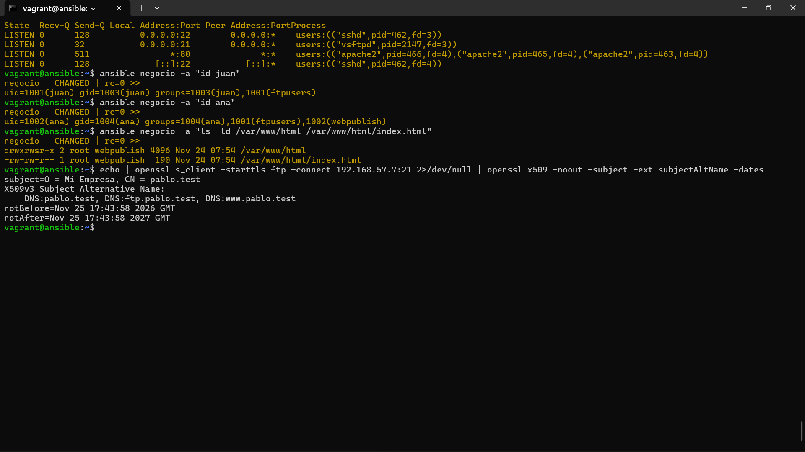

**Acceso anónimo rechazado.** Desde Windows, con `curl` y TLS obligatorio (`--ssl-reqd`). El `-k` sirve para aceptar el certificado autofirmado. El servidor contesta `530`.

```
curl -v --ssl-reqd -k ftp://ftp.pablo.test/ --user anonymous:
```

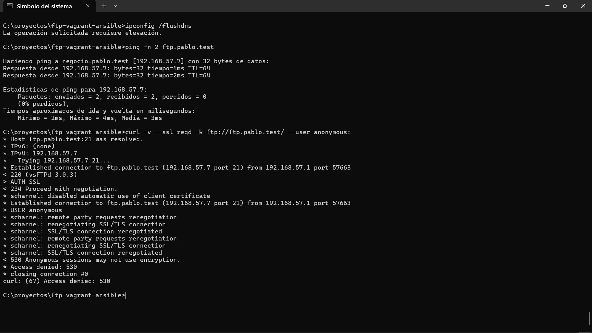

**Usuario no autorizado rechazado.** Con un usuario que no existe (`pepe`), PAM no lo autentica y responde `530 Login incorrect`.

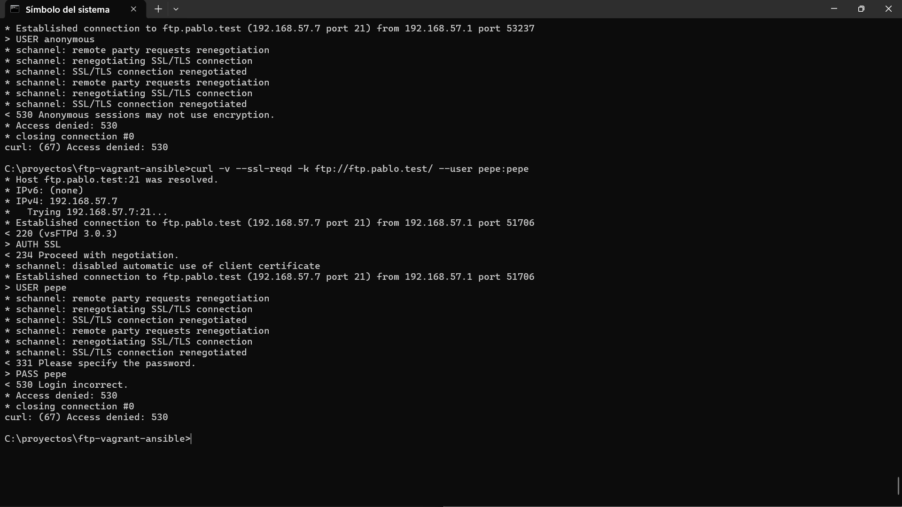

---

## 9. Pruebas con FileZilla

### 9.1. ana

En el Gestor de sitios de FileZilla creé un sitio apuntando a **`ftp.pablo.test`**, por nombre y no por IP, con el puerto 21, cifrado FTP explícito sobre TLS y el usuario `ana`.

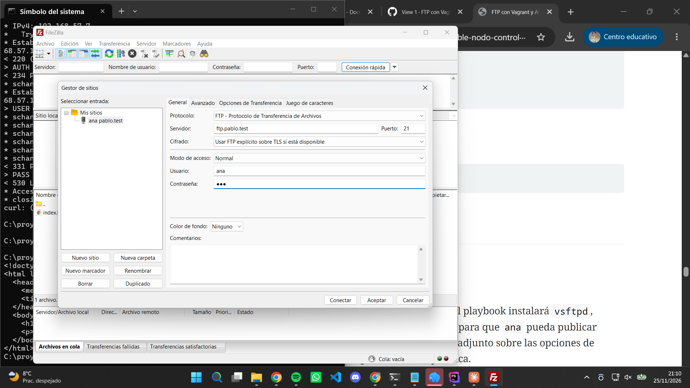

La primera vez, FileZilla pregunta si quiero que guarde las contraseñas de los sitios.


Al conectar, en el registro se ve todo el proceso: resuelve `ftp.pablo.test` a `192.168.57.7`, establece la conexión e inicia TLS. ana aparece directamente en **`/var/www/html`** gracias a su `local_root`. La barra de título muestra `ftpes://ana@ftp.pablo.test`.


Subí un `index.html` modificado y sobrescribí el existente. FileZilla confirma la transferencia: el tamaño pasa de 190 a 267 bytes y aparece *Transferencias satisfactorias (1)*. La subida funciona porque ana está en `webpublish` y el fichero tiene permiso de escritura para el grupo.

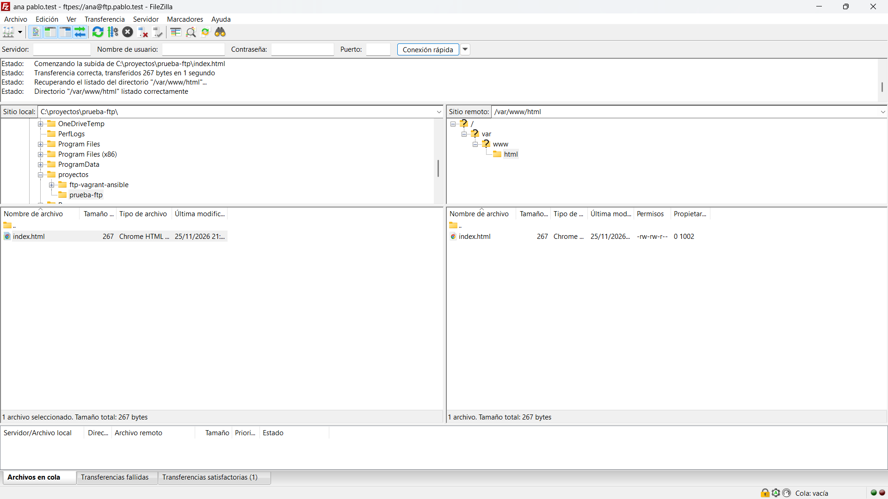

Al recargar `http://www.pablo.test`, Apache ya sirve la página nueva:


### 9.2. juan

Dupliqué el sitio y cambié el usuario a `juan`.

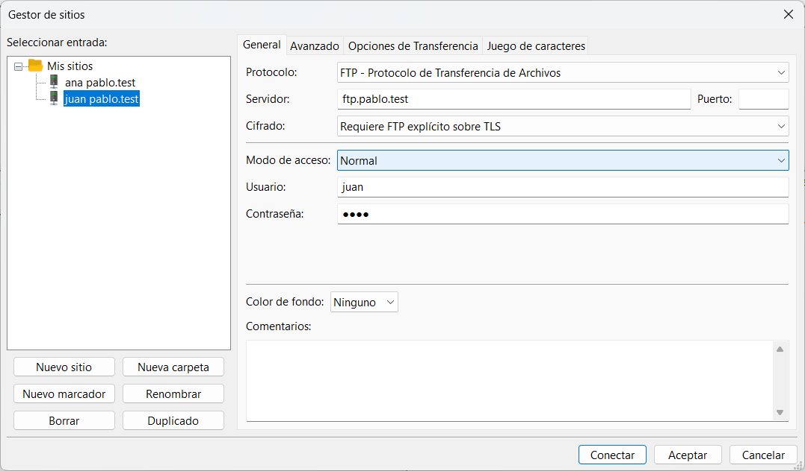

juan entra y su directorio remoto es **`/`**, vacío. En realidad está viendo `/home/juan`, porque vsftpd le ha hecho un chroot y, para él, esa carpeta es la raíz del sistema.


Si intento ir a `/var/www/html`, el servidor responde `550 Failed to change directory`. Dentro de su jaula esa ruta no existe.

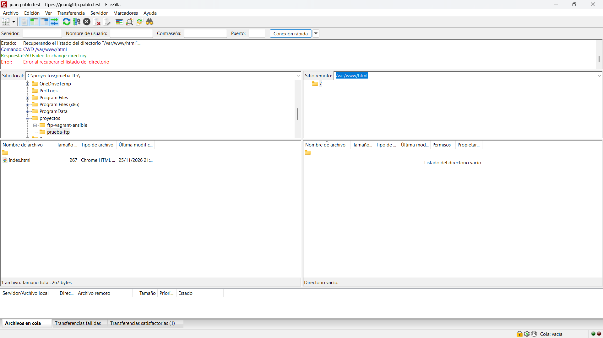

Lo que sí puede hacer es subir ficheros a su propia carpeta. Ese fichero queda en `/home/juan` con dueño juan, y la web no cambia.

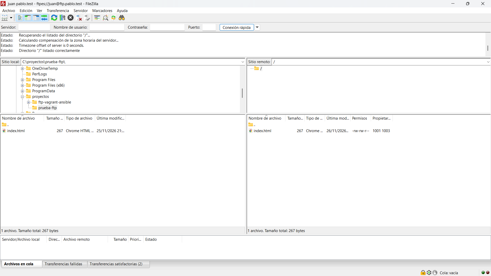

---

## 10. Provisión completa y tablero final

Para cerrar, descomenté en `ansible.sh` las tres líneas que ejecutan los playbooks:

```bash
ansible-playbook dns/dns.yml
ansible-playbook web/web.yml
ansible-playbook ftp/ftp.yml --vault-password-file ./.vault_pass.txt
```

Así, un `vagrant provision ansible` deja el entorno configurado de principio a fin sin escribir ningún comando dentro de las máquinas. Como los módulos de Ansible son idempotentes, en una segunda ejecución casi todo sale `ok` y solo cambia lo que hace falta.


Con el commit final (`Closes #29` … `Closes #40`), todas las issues pasaron a **Hecho**:


---

## 11. Problemas que me encontré y cómo los resolví

No todo salió a la primera. Estos son los problemas que tuve por el camino:

**Los usuarios no podían entrar por FTP.** Fue el que más tiempo me llevó. FileZilla conectaba con el servidor y el cifrado funcionaba, pero al poner la contraseña el servidor decía que era incorrecta, tanto con ana como con juan. Al final descubrí que el problema estaba en las contraseñas que había guardado en el vault: en el primer intento me olvidé de cambiar los marcadores por las contraseñas de verdad, y en el segundo se me coló algún carácter al escribirlas. Las volví a generar con más cuidado, las guardé otra vez en el vault, lancé de nuevo el playbook y ya pudieron entrar los dos.

**Mi ordenador no encontraba los nombres de la práctica.** Desde el servidor DNS todo resolvía bien, pero el navegador no encontraba `www.pablo.test`. Tuve que configurar Windows para que, solo para los nombres terminados en `.test`, preguntara al DNS de la práctica. Así el resto de internet sigue funcionando con normalidad.

**Me quedé sin espacio en el disco.** Las máquinas virtuales ocupan bastante y en un momento se me llenó el disco. VirtualBox pausaba las máquinas y una instalación se quedó a medias. Borré máquinas de prácticas antiguas que ya no usaba y reparé la instalación que se había cortado.

**La hora de las máquinas se desajustaba.** Cuando una máquina se quedaba en pausa, al volver tenía la hora atrasada y no podía descargar paquetes. Apagándola y encendiéndola de nuevo se solucionaba.

**Una máquina se quedó sin internet.** Después de suspender el ordenador, `negocio` dejó de tener conexión y el playbook se quedaba esperando sin avanzar. Reiniciando esa máquina volvió a funcionar.

**El Bloc de notas me dio guerra.** A veces no guardaba los cambios o añadía `.txt` al nombre de los ficheros. Además, los ficheros escritos en Windows guardan los saltos de línea de otra forma que Linux, y eso hacía fallar los scripts. Me acostumbré a comprobar siempre que los ficheros se habían guardado bien y a convertirlos antes de usarlos en las máquinas.

**Ejecutar comandos en el sitio equivocado.** Al principio a veces escribía comandos de Git dentro de la máquina virtual, o lanzaba algo en `negocio` cuando tenía que ser en `ansible`. Aprendí a mirar siempre en qué máquina estaba antes de ejecutar nada.

---

## 12. Cambios respecto al enunciado

- **Rutas del certificado.** El texto habla de `/etc/ssl/equipo/`, pero el playbook usa `{{ cert_dir }}` = `/etc/ssl/ftp`. Seguí el playbook, porque es lo que tiene que coincidir con `vsftpd.conf`.
- **Raíz FTP de ana.** El enunciado pide que esté en `/var/www/html`, pero el playbook no tenía ninguna tarea para eso. Añadí `ftp/files/ana` y dos tareas: crear `/etc/vsftpd_user_conf` y copiar el fichero.
- **`chown` de `.vault_pass.txt`.** El script hace `chmod 600` sobre un fichero que crea root, así que el usuario `vagrant` no podría leerlo. Añadí `chown vagrant:vagrant`.
- **Ubicación del vault.** `ansible-vault create ftp/vars/vault.yml` dentro de la máquina lo crearía en la copia de trabajo (`~/ftp`), que no está sincronizada con Windows. Lo creé en `/vagrant/ftp/vars/` para que llegara al repositorio.
- **Claves SSH.** Las copio a `/home/vagrant/claves` en vez de leerlas desde `/vagrant/.vagrant/...`, por los permisos `0777` de la carpeta compartida en Windows.

---

## 13. Riesgos de seguridad

- **`vault_pass.txt` en un repositorio público.** Cualquiera puede descifrar el vault. Lo pide el enunciado, pero en un caso real la contraseña iría en una variable de entorno o en un gestor de secretos.
- **Certificado autofirmado.** El cifrado funciona, pero el cliente no puede verificar la identidad del servidor (por eso uso `-k` en curl y FileZilla avisa). En producción se usaría un certificado de una autoridad reconocida.
- **`allow_writeable_chroot=YES`** relaja una protección de vsftpd (ver 8.2).
- **`host_key_checking = False`** desactiva la comprobación de la identidad SSH de los servidores.
- **La clave insegura de Vagrant** es pública: solo sirve en un laboratorio.
- **Contraseñas triviales** (`juan`, `ana`): con un hash SHA-512 se rompen en segundos por diccionario.
- **Puerto 21 y rango pasivo abiertos.** En la red privada no importa, pero en un servidor expuesto habría que filtrarlos con un cortafuegos.

---

## 14. Conclusión

Lo que más valoro de la práctica es haber tratado la infraestructura como código: el estado de los tres servidores está descrito en ficheros versionados, y Ansible se encarga de llevarlos a ese estado de forma repetible. También he aprendido a comprobar cada requisito con la herramienta adecuada (`dig`, `curl`, `ss`, `openssl`, `journalctl`) y a seguir los errores hasta su causa en lugar de probar cosas a ciegas. El caso de las contraseñas del FTP es el mejor ejemplo: el fallo no estaba en el servidor, sino en las contraseñas que yo había guardado.

La última comprobación que pide el enunciado era borrar todo, clonar el repositorio y hacer `vagrant up`. La intenté: las máquinas se crearon y el DNS y la web se provisionaron solos, pero la máquina `negocio` se quedó bloqueada durante la tarea del certificado y no llegué a completar esa prueba.
